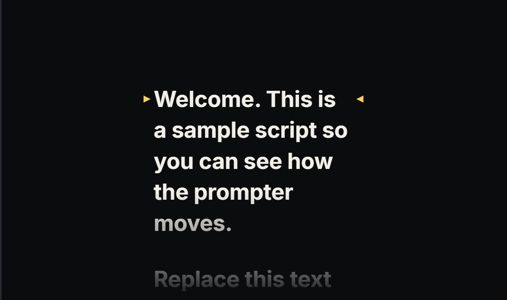
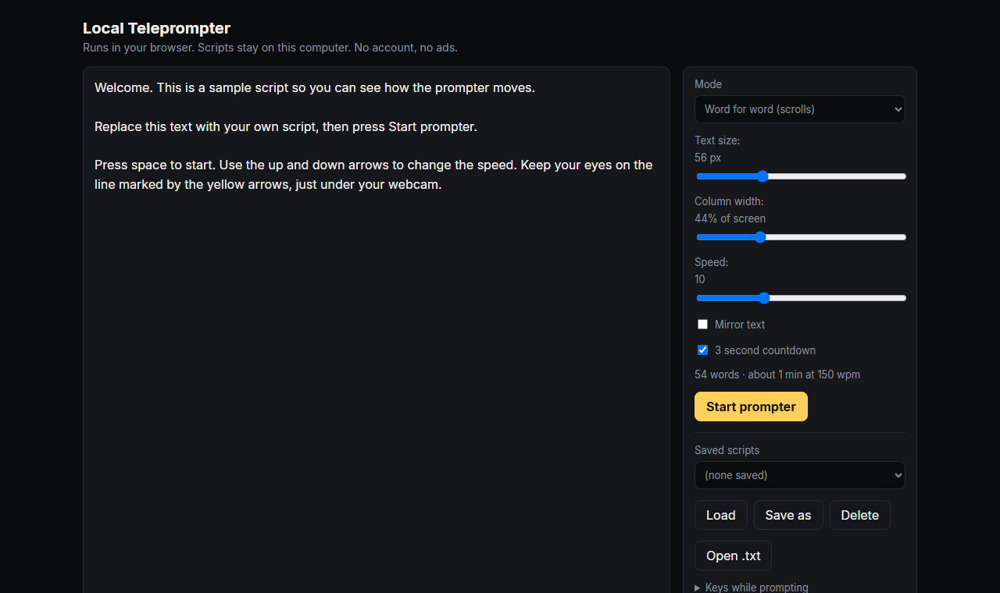

# Eyeline

**A teleprompter that keeps your eyes where the camera is.** One HTML file. No account, no ads, no install, no server.
Your scripts stay in your own browser.

  

  

## Why

Most teleprompters stretch the text across the full screen, so your eyes sweep left and right while you read. On camera
that looks like you are reading. Eyeline puts the text in a **narrow column** you can park right under your webcam, so
your eyes stay close to the lens.

## Run it

Download `index.html` and double-click it. It opens in your default browser. That is all.

## Features

- **Narrow centred column**, with adjustable column width and text size.
- **Reading marker.** A yellow marker shows the reading line, and the text above and below fades out.
- **Word for word mode.** The script scrolls at a speed you set, with an estimated words-per-minute readout for your
  script.
- **Bullets mode.** One line at a time. You move on with a key or a click.
- Optional **3 second countdown**, **mirror mode**, a progress bar, and elapsed and remaining time.
- **Saved scripts** and your last draft, kept in the browser. You can also open a `.txt` or `.md` file.
- Controls hide themselves after a moment without mouse movement.

## Keys while prompting

| Key | Action |
|---|---|
| Space | Start or pause (next bullet in bullets mode) |
| Up / Down | Speed (previous / next bullet in bullets mode) |
| Left / Right | Previous / next bullet (small jump in scroll mode) |
| + / - | Text size |
| [ / ] | Column width |
| M | Mirror |
| R | Restart |
| F | Full screen |
| ? | Show or hide key help |
| Esc | Back to the editor |

Mouse: click the text to pause or advance, use the wheel to scroll, use the bar at the bottom.

## Tips

- Put the browser window at the top of the screen, directly under the webcam, and raise your laptop to eye level.
- Mirror mode is for a beam-splitter glass rig. Leave it off for a normal screen.
- Saved scripts live in your browser's local storage. Clearing site data deletes them, so copy anything important to a
  file.

## Status

Version 1. English only. Checked in a real Chrome window with Playwright: scrolling, pause, speed, mirror, restart,
both modes, saved draft and a narrow window. The test script is not included.

**Planned, not built:** voice-follow (the prompter listening and keeping pace with you), and an Android version.

## License

MIT, see `LICENSE`.
